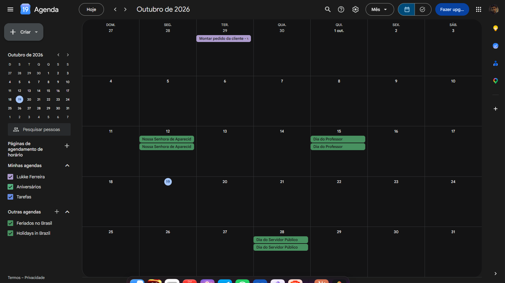
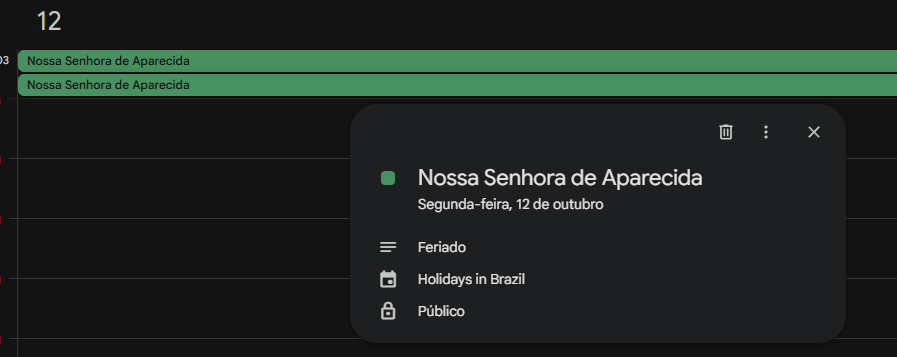
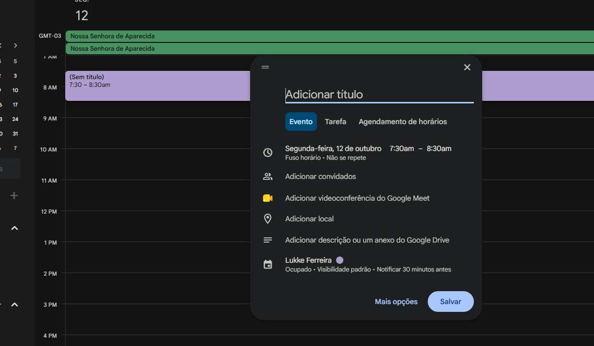
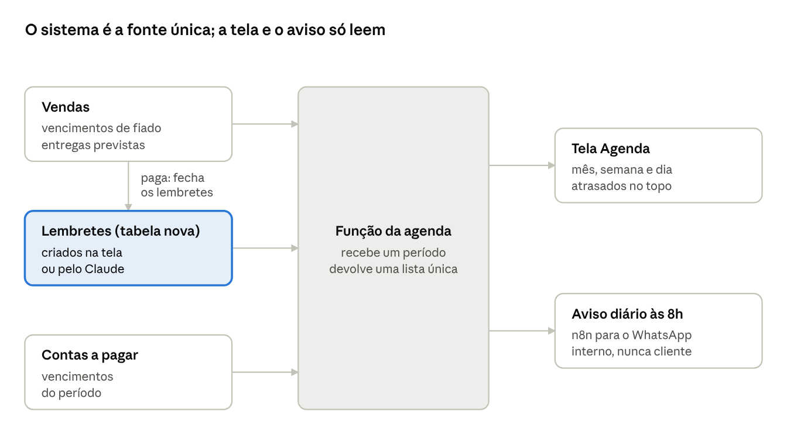

# Agenda de Retornos — Mont

19/10/2026 · Luccas

> Planejamento do módulo Agenda do sistema interno. Os prompts para o Claude Code estão em [`prompts/`](prompts/), um por onda, para colar em ordem. Imagens de referência em [`img/`](img/).

## Por que

A Mont precisa de uma Agenda dentro do sistema interno, com visão de mês igual ao Google Agenda, onde cada retorno com cliente fica registrado no dia certo e ligado ao cliente e à venda. Hoje os retornos vivem em quatro lugares diferentes e nenhum deles avisa ninguém.

Só na cobrança de 19/10 apareceram estes casos:

| Retorno | Onde está registrado hoje | Risco |
| --- | --- | --- |
| Ana Maria — 1ª parcela 07/11 | Campo de previsão de pagamento da venda | Só vê quem abre a venda |
| Ana Maria — 2ª parcela 07/12 | Texto livre na observação | Esquecido com certeza |
| Silvania (30/11), Claudete (13/11) | Previsão de pagamento | Só vê quem abre a venda |
| Ritinha, Andrea, Vilma, Patrícia — confirmar com o Gilmar | Conversa com o Claude e lembrete externo | Some se a conversa acabar |
| 54 vendas que vencem em 13/11 | Previsão de pagamento | Ninguém é avisado na véspera |

Google Agenda foi descartado como fonte principal: o evento não sabe quando a venda é paga, então fica "cobrar Adriana" na agenda depois de ela já ter pago. O sistema é a fonte da verdade; a Agenda é uma tela dele.

## Brainstorm: o que entra na Agenda

A ideia central é copiar a lógica do Google Agenda de "Minhas agendas" e "Outras agendas": a tela mostra **lembretes** (registros novos, criados à mão) e **camadas** (datas que o sistema já tem, mostradas sem copiar nada). Cada camada liga e desliga num checkbox na lateral, igual aos Feriados no Google.

Mostrar as datas que já existem como camada evita o maior risco: dado duplicado. O vencimento de um fiado não vira um registro novo; ele é lido da venda. Quando a venda é paga, ele some sozinho da agenda.

| O que aparece | Exemplo real | Tipo | Como nasce | Como sai da agenda |
| --- | --- | --- | --- | --- |
| Vencimento de fiado | 54 vendas em 13/11 | Camada | Data de previsão de pagamento da venda | Venda paga |
| Entrega prevista | Alice, 20/10 | Camada | Data de entrega prevista da venda | Venda entregue |
| Conta a pagar | Parcela de fornecedor | Camada | Vencimentos do módulo Contas a Pagar | Conta paga |
| Parcela combinada | Ana Maria, 2ª parcela 07/12 | Lembrete | Manual, ligado à venda | Automático quando a venda fica paga, ou manual |
| Retorno de cobrança | Follow-up no dia 3 e no dia 7 sem resposta | Lembrete | Manual, ligado à venda | Automático quando a venda fica paga, ou manual |
| Pendência interna | Confirmar Ritinha e Andrea com o Gilmar | Lembrete | Manual, ligado ao cliente | Manual |
| Retorno comercial | "Me chama semana que vem" | Lembrete | Manual, ligado ao cliente | Manual |
| Recompra prevista | Cliente que compra a cada 20 dias | Camada (fase futura) | Cálculo do ciclo médio de compra | Cliente compra de novo |

Regra de negócio que a Agenda precisa respeitar: cliente com fiado em aberto nunca recebe lembrete de venda ou reativação. Ao criar um retorno comercial para esse cliente, a tela avisa e sugere um retorno de cobrança.

## Modelo de dados

Só uma tabela nova, `lembretes`. As camadas saem de uma única função de leitura que junta lembretes e datas existentes num formato só, para a tela pedir "tudo entre 01/11 e 30/11" numa chamada.

**Tabela `lembretes`** (o Claude Code define tipos e nomes finais seguindo o padrão das outras tabelas):

| Campo | Para que serve |
| --- | --- |
| título, descrição | O que fazer, em uma linha, e o contexto |
| data, hora (opcional) | Sem hora = dia inteiro, como no Google |
| tipo | parcela, cobrança, pendência interna, retorno comercial, outro |
| cliente (opcional) | Liga ao cadastro do contato |
| venda (opcional) | Liga à venda; é o que permite fechar sozinho |
| responsável (opcional) | Luccas, Gilmar, equipe |
| situação | pendente, feito, cancelado |
| concluído em, concluído por, motivo | Motivo = manual, venda paga ou venda cancelada |
| vezes reagendado | Mostra o retorno que fica sendo empurrado |
| origem | manual, automação ou Claude |
| auditoria | criado em, criado por, alterado por (padrão atual) |

**Regras no banco, não na tela:**

1. Quando uma venda passa para paga, todos os lembretes pendentes de tipo parcela ou cobrança ligados a ela fecham com motivo "venda paga".
2. Venda cancelada fecha os lembretes dela como cancelados.
3. Mesma política de acesso (RLS) das outras tabelas do sistema interno.

**Função de leitura da agenda** (recebe início e fim do período e devolve uma lista única):

- Lembretes do período.
- Vencimentos: vendas não pagas e não canceladas com previsão de pagamento no período, com valor em aberto (total menos o já pago).
- Entregas: vendas pendentes com entrega prevista no período.
- Contas a pagar com vencimento no período.
- Cada item volta com: origem, id, data, hora, título, cliente, valor, situação e o link para abrir o registro original.

Um achado para tratar junto: fiado sem previsão de pagamento não aparece em lugar nenhum. A tela mostra um contador "X fiados sem data" que abre a lista para preencher.

## Telas

A referência visual são os prints do Google Agenda abaixo, adaptados ao design system atual do sistema (tokens, Portal pattern, tema escuro). O que não existe no Google e a Mont precisa: a faixa de **Atrasados** e as ações de cobrança no detalhe.

**1. Visão do Mês (tela principal)**

- Cabeçalho: botão Hoje, setas anterior e próximo, nome do mês, seletor Mês / Semana / Dia, busca.
- Lateral: botão Criar, mini-calendário, lista de camadas com checkbox e cor (Lembretes, Vencimentos, Entregas, Contas a pagar). As escolhas ficam salvas no navegador.
- Grade de 7 colunas, semana começando no domingo, dia de hoje destacado.
- Cada dia mostra até 3 itens em chip colorido pela camada e um "+N mais" que abre o dia.
- Chip de vencimento mostra cliente e valor em aberto ("Ana Maria · R$ 32,50"). Vários vencimentos no mesmo dia viram um chip só: "13 vencimentos · R$ 1.240".
- Faixa de Atrasados acima da grade: lembretes pendentes com data passada, com contador e valor somado.

**2. Visão do Dia e da Semana**

- Itens de dia inteiro no topo, itens com hora na linha do horário.
- No celular (PWA, uso do Gilmar), o mês vira pontinhos por dia e a lista do dia escolhido aparece embaixo.

**3. Detalhe do item (popover ao clicar)**

- Título, data, tipo, cliente, venda e valor em aberto.
- Ações: Marcar como feito, Reagendar (+1 dia, +7 dias, escolher data), Abrir venda, Abrir cliente, Abrir conversa no WhatsApp, Excluir.
- Item de camada (vencimento, entrega) não é editável ali: o botão leva ao registro original. Terá também "Criar retorno" para virar lembrete.

**4. Criação rápida (clicar num dia vazio ou em Criar)**

- Título, data (já preenchida com o dia clicado), hora opcional.
- Abas no lugar de Evento / Tarefa: Cobrança, Parcela, Pendência, Retorno comercial.
- Busca de cliente; ao escolher, lista as vendas em aberto dele para ligar.
- Botão Salvar e "Mais opções" para descrição e responsável.

**5. Atalhos em outras telas**

- Botão "Agendar retorno" na tela da venda e na do contato, abrindo a criação rápida já preenchida.
- Bloco "Retornos de hoje" no Dashboard com o contador de atrasados.

## Automações

A tela resolve quem abre o sistema; o aviso no WhatsApp resolve quem não abre. As três automações abaixo são o que tira a dependência de lembrar.

Nada é copiado: a tela e o aviso leem a mesma função, e só a tabela de lembretes recebe escrita nova.

1. **Fechamento automático.** Regra no banco: venda paga fecha os lembretes de cobrança e parcela dela; venda cancelada cancela. Ninguém cobra quem já pagou.
2. **Aviso diário interno.** Um workflow novo no n8n, no mesmo molde do W5 de entregas, chama uma ação nova na função do Supabase e manda uma mensagem interna (nunca para cliente) com:
    - Atrasados: quantidade, nomes e valor somado.
    - Hoje: lembretes do dia e vencimentos do dia com valor total.
    - Amanhã: só o total de vencimentos, para preparar.
    - Se não houver nada, não manda mensagem.
3. **Lembretes criados pelo Claude.** Quando um combinado com cliente for fechado nas conversas (como as parcelas da Ana Maria), o Claude grava o lembrete direto na tabela com origem "Claude". Ele aparece na agenda e no aviso do dia seguinte sem ninguém digitar.

O aviso nunca dispara mensagem para cliente. Cobrança continua passando pela aprovação do Luccas ou do Gilmar.

## Plano em ondas

Cinco ondas, uma peça por vez, cada uma com checkpoint antes da próxima. As ondas 1 e 2 entregam a maior parte do valor (nenhum retorno esquecido) antes de existir qualquer tela.

| Onda | Prompt | Entrega | Valor | Esforço | Pronto quando |
| --- | --- | --- | --- | --- | --- |
| 0. Diagnóstico | [00](prompts/00-diagnostico.md) | Relatório do Claude Code sobre o repositório, sem alterar nada | Evita frankenstein | Baixo | Você aprova o plano dele |
| 1. Banco | [01](prompts/01-banco.md) | Tabela de lembretes, regras de fechamento, função da agenda | Alto: o Claude já grava retornos | Baixo | SQL revisado e testado no editor do Supabase |
| 2. Aviso das 8h | [02](prompts/02-aviso-diario.md) | Workflow novo no n8n e ação nova na função do Supabase | Alto: o lembrete chega sozinho | Baixo | Primeira mensagem real recebida no WhatsApp |
| 3. Tela do Mês | [03](prompts/03-tela-mes.md) | Visão do mês, camadas, detalhe e criação rápida (desktop) | Médio | Médio | Checklist de teste da tela passando |
| 4. Acabamento | [04](prompts/04-acabamento.md) | Dia e Semana, celular, atalhos em venda e contato, bloco no Dashboard | Médio | Médio | Gilmar usa pelo celular sem ajuda |

Depois, se fizer sentido: camada de recompra prevista (o Dashboard já calcula alertas de recompra) e espelho somente-leitura no Google Agenda.

Como não há ambiente de teste, toda migração segue o protocolo: dump do schema antes, o agente gera o SQL para revisão, você testa no editor do Supabase e só então autoriza.

## Checkpoints

**Onda 0**
- [ ] Relatório de diagnóstico recebido, com caminhos de arquivo
- [ ] Plano das ondas aprovado

**Onda 1**
- [ ] Dump do schema feito antes
- [ ] SQL revisado e bloco de teste com ROLLBACK passando no SQL Editor
- [ ] Migração aplicada e SELECT de conferência feito
- [ ] Claude grava os retornos de 19/10: Ana Maria 07/11 e 07/12, Patrícia, Vilma, Ritinha e Andrea com o Gilmar

**Onda 2**
- [ ] Texto simulado conferido contra o banco
- [ ] Primeira mensagem das 8h recebida de verdade
- [ ] Segundo disparo no mesmo dia bloqueado

**Onda 3**
- [ ] 13/11 mostra os vencimentos com total igual ao banco
- [ ] Criar, reagendar, marcar feito e excluir funcionando
- [ ] Lembrete some dos pendentes quando a venda é paga

**Onda 4**
- [ ] Gilmar usa pelo celular sem ajuda
- [ ] Atalho na venda e no contato funcionando
- [ ] Dashboard e Agenda com o mesmo número de atrasados

## Decisões em aberto

| Decisão | Sugestão | Por quê |
| --- | --- | --- |
| Quem recebe o aviso das 8h | Seu número primeiro; grupo Equipe depois de uma semana | Validar o texto antes de expor à equipe |
| Aviso no sábado e no domingo | Segunda a sábado | Domingo não tem rotina de cobrança |
| Gilmar cria lembretes ou só consulta | Cria e marca como feito | Ele é quem combina com o cliente no dia a dia |
| Fiados sem previsão de pagamento | Contador na Agenda para preencher | Hoje esses fiados não aparecem em lugar nenhum |
